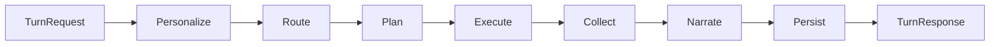
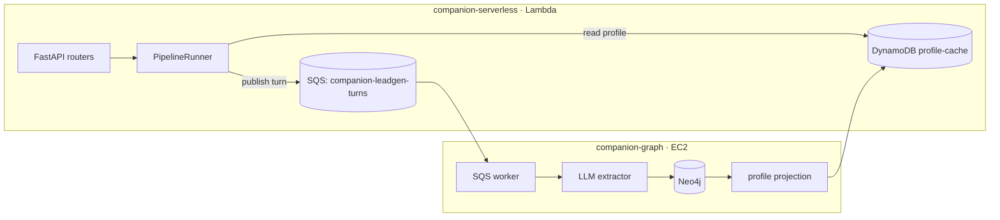

# Companion — Target Architecture

> Status: **target** (the rewrite implements this incrementally on `dev`; see the ADRs in
> `docs/architecture/adr/`). This is the written design issue #26 asks for so the rewrite is
> reviewed, not blindly generated.

## 1. What the system does

Companion is a multi-provider assistant: a user message is routed to a domain (food delivery,
q-commerce, going-out, finance, mobility, maps, reminders, phone, chit-chat), one or more provider
plugins plan and execute tool calls (mostly via MCP), and the assistant narrates the result with
rich attachments (restaurant/menu/cart cards, payment QR, etc.). The same path serves text chat and
realtime **voice**. A separate **knowledge-graph / leadgen** subsystem learns from each turn
asynchronously and personalizes future turns.

It runs serverless: **FastAPI on AWS Lambda** (via Mangum, `companion-serverless` stack) behind an
HTTP API Gateway. The knowledge graph runs on its own EC2 stack (`companion-graph`) fed by SQS.

## 2. Main pipeline vs parallel pipelines

The **main pipeline** is one explicit, ordered sequence of small, individually testable stages.
Chat and voice run the *same* pipeline.



| Stage | Responsibility |
|-------|----------------|
| **Personalize** | Read user profile (KG seam, fail-open) + resolve home/office address. |
| **Route** | Orchestrator LLM → `RoutingDecision{task_type, providers[], reasoning}` (+ stickiness). |
| **Plan** | Per-provider planner LLM → validated `ToolPlan` (merged when several providers). |
| **Execute** | Provider fan-out → normalized `ToolResult`s. |
| **Collect** | `provider.build_attachments(results)` in a fixed priority order. |
| **Narrate** | Response LLM → `assistant_message` + LLM-driven card/cart filtering. |
| **Persist** | Per-provider session merge + non-blocking side-channels (leadgen, message store). |

**Parallel pipelines** are two distinct things layered on the main pipeline:

1. **Provider fan-out inside `Execute`** — `asyncio.gather` over the routed providers, tolerant of
   partial failure. When the user names an app, `Route` returns just that provider; when none is
   named, it returns *all relevant* providers for the task and `Execute` runs them concurrently
   (issue #14: provider-agnostic by default).
2. **Side-channel async inside `Persist`** — leadgen enqueue and message persistence run without
   blocking the user-facing response.

The whole pipeline is **async-first** (`async/await` end-to-end; no `asyncio.run` buried in
executors). Mangum drives the event loop on Lambda. This is what lets voice reuse the pipeline and
makes fan-out possible (see ADR-0003).

## 3. Package map (`core/`, every file ≤250 lines)

```
core/
  contracts/      pure Pydantic: Tool, ToolCall/ToolPlan, ToolResult, SessionState,
                  Attachment, TurnRequest/TurnResponse, RoutingDecision
  llm/            async LLM client, robust JSON parser, ResolvedLlm,
                  function_calling (Tool -> OpenAI/Gemini/Anthropic fn-call schema)
  registry/       ProviderRegistry + ToolRegistry + bootstrap.py (the one registration point)
  middleware/     planner_prompt (generated), validator (jsonschema), dispatcher (registry-driven),
                  confirmation, errors, tracing
  pipeline/       runner.py + stage.py + stages/{personalize,route,plan,execute,collect,narrate,persist}
  providers/
    base.py       Provider protocol (the plugin interface)
    mcp/          shared MCP base: connection+token mgmt, placeholders, address_resolver, result_parse
    http/         shared HTTP base (statically-declared tools)
    plugins/      one small folder per provider
  boundaries/     KG/leadgen seam: TurnEventPublisher + ProfileReadService protocols (+ impls)
  app_factory.py  wires registry + boundaries + llm into a PipelineRunner
```

The web layer (`companion_api/`) becomes thin `APIRouter` modules that validate input, call
`await runner.run(...)`, and serialize the envelope.

## 4. Unified tool schema + registry (issue #27)

One `Tool` model describes **both** MCP-discovered tools and statically-declared HTTP tools:

```python
class Tool(BaseModel):
    name: str; provider: str; description: str
    params: dict                 # JSON Schema; from MCP inputSchema or declared literal
    auth_mode: AuthMode          # oauth | url | tool | none
    confirm: ConfirmPolicy       # never | single | two_step
    mutating: bool = False
    session_reads: tuple[str, ...] = ()
    placeholder_outputs: tuple[str, ...] = ()
    source: Literal["mcp", "static"] = "mcp"
```

From this single registry the system derives everything: which providers exist, which provider owns
a tool (dispatch), the **generated planner-prompt tools block** (replacing hand-written markdown
lists and `_ALLOWED_TOOLS` frozensets), and the **argument validator** (jsonschema). Adding a
provider no longer means editing the dispatcher, the orchestrator's known-sets, a planner, and a
prompt — it is a plugin plus one registration line (see ADR-0002).

## 5. Provider plugin interface

```python
class Provider(Protocol):
    id: str; label: str; auth_mode: AuthMode
    session_cls: type[ProviderSessionState] | None   # None => stateless (e.g. twilio)
    async def discover_tools(self) -> list[Tool]: ...
    async def execute(self, call: ToolCall, ctx: ExecCtx) -> ToolResult: ...
    def build_attachments(self, results: list[ToolResult]) -> list[Attachment]: ...
    def merge(self, session, results) -> ProviderSessionState: ...
```

`McpProvider` implements `discover_tools`/`execute` once, composing shared helpers (connection +
token management, placeholder substitution/learning, address resolution incl. Swiggy dual-key,
result parsing). A concrete MCP plugin only declares its identity, `session_cls`, per-tool
placeholder outputs, and `build_attachments`/`merge` — roughly 200 lines instead of a 3,500-line
executor.

## 6. Session state

A typed `SessionState` holds namespaced per-provider sub-states; each plugin owns its own `merge()`
(replacing the ~28 `session_*` kwargs and a 300-line merge loop). The HTTP envelope keeps identical
top-level `session_*` keys (via aliases) so in-flight frontend sessions round-trip unchanged during
migration.

## 7. KG / leadgen boundary (issue #28)

The pipeline depends on two protocols only — it imports neither `leadgen_queue`, `profile_cache`,
nor `graph_client`:

```python
class TurnEventPublisher(Protocol):
    async def publish(self, event: TurnEvent) -> None: ...
class ProfileReadService(Protocol):
    async def get(self, user_id: str) -> Profile | None: ...   # fail-open
```

`Personalize` consumes `ProfileReadService`; `Persist` consumes `TurnEventPublisher`. Concrete
impls adapt the existing repos and SQS queue, unchanged. The EC2/Neo4j worker evolves independently
behind this seam.



## 8. Deployment topology

| Stack | Provisions |
|-------|-----------|
| `companion-serverless` | API Lambda (Docker image), Reminder Lambda, Cognito, transactional DynamoDB (families/members/messages/reminders), Secrets, EventBridge scheduler. |
| `companion-graph` | SQS turns queue + DLQ, profile-cache + lead-cache DynamoDB, EC2 (Neo4j + graph service + worker). |

Environments are parameterized by an `environmentName` CDK context (`dev`/`staging`/`prod`) that
drives stack names, domains, secret ids, and table names (see ADR-0005).

## 9. Conventions

See `CONTRIBUTING.md`: ≤250 lines/file, ruff lint+format, per-component tests with markers, and the
`feature → dev → staging → main` flow.
